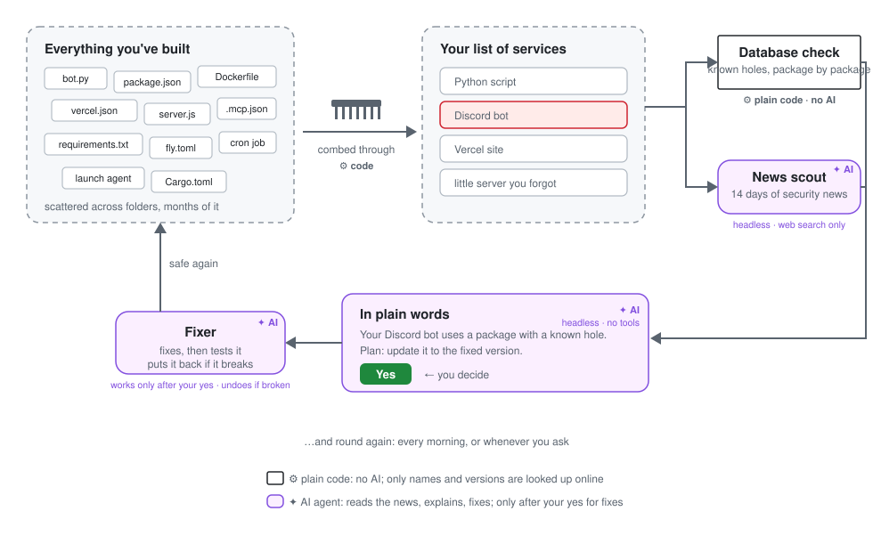

# stack-guard

Made by House of Solance · free for noncommercial use · credit required

stack-guard checks everything you build and run for known security holes, tells you in plain words, and fixes the safe ones once you say yes.

<div align="center">

🛡️

***Your setup is yours alone.** A Python script here. A Discord bot there. A site on Vercel. A little server you forgot to shut down. All of it runs on code other people wrote, and any of it can have a hole.*

*The fixes get published. But there's no recall: nobody tells the people running the broken version.*

***stack-guard sends you that alert.** It finds everything you run, even what you forgot. It watches every warning and every patch for all of it. When one is yours, it tells you plainly, plans the fix, and does it safely once you say yes.*

</div>

<p align="center"></p>

## Quick start

**Let your AI do it.** Copy this and send it to Claude Code:

```
Please install stack-guard for me. Run:
claude plugin marketplace add SolanceLab/plugins
claude plugin install stack-guard@solancelab
Then guide me through the rest, step by step.
```

Using Codex? Send the same message with `codex plugin marketplace add SolanceLab/plugins` and `codex plugin add stack-guard@solancelab`.

**Or do it yourself.**

```
claude plugin marketplace add SolanceLab/plugins
claude plugin install stack-guard@solancelab
```

In Codex: `codex plugin marketplace add SolanceLab/plugins`, then `codex plugin add stack-guard@solancelab`. Start a new conversation and ask: *run stack-guard on this folder*.

Installed it earlier from `SolanceLab/stack-guard`? That still works, and the daily watch follows you if you move to the store above (from 1.8.2). Moved to the store above before version 1.8.2? Run `/stack-guard:watch` once, and the morning check will follow you from then on.

## What it is

**One prompt to check everything you build and run with Claude Code or Codex for known security holes, and fix the safe ones.** It finds what you run, checks the public vulnerability databases and this fortnight's security news for your exact versions, tells you in plain words, and fixes what can be fixed safely, after your yes. The full list: [What it does](docs/what-it-does.md).

## What you need

Claude Code or Codex. Node/npm for JavaScript projects. For Python, [`uv`](https://docs.astral.sh/uv/) (or `pipx`) makes the check faster.

## Use

Open Claude Code in your project folder and type `/stack-guard`. Add `--audit-only` to change none of your code or packages (it only writes its report). `/stack-guard:watch` sets up a daily check on your own computer; `/stack-guard:inventory` writes a plain list of everything you run. All options: [Using stack-guard](docs/commands.md) · [Updating](docs/updating.md).

## Settings

Four settings: the secret guard, the final-reply check and the daily update check (all on), and how long a fix must have been public before it is installed (48 hours). Change them with `/plugin configure stack-guard@solancelab`. Details: [Settings](docs/settings.md).

## Tools

| Tool | What it does |
|---|---|
| `/stack-guard` | Finds what you run, checks it, reports in plain words, and offers the safe fixes. In Codex: `$stack-guard:run-stack-guard`. |
| `/stack-guard:inventory` | Writes `STACK-INVENTORY.md`, a plain list of everything you build and run. |
| `/stack-guard:watch` | Sets up the daily routine on your own computer, after your yes. |
| Skills | `stack-guard` (where to start), `run-stack-guard`, `stack-audit`, `stack-fix`, `stack-breach-check`. |
| Agents | `stack-auditor`, `stack-news-scout`, `stack-breach-checker` (read-only) and `stack-fixer` (only after your yes). |
| Hooks | The secret guard (three hooks) and the daily update check; each can be switched off in Settings. |

## Limits

It does not scan container images, GitHub Actions or package signatures, and it checks only the usual secret files, not every file. macOS and Linux are fully supported; Windows is best effort. The full list: [Limits](docs/limits.md).

## Safety

- It never deploys, pushes, commits, upgrades Node/Python or restarts services on its own. It hands you the command and waits for your yes.
- First time? [Before you run it](docs/before-you-run.md): back up, start with `--audit-only`, turn on the sandbox.
- [Was I hit?](docs/was-i-hit.md): for each serious hole, it checks whether it could have been used against you.
- [Secret guard](docs/secret-guard.md): while stack-guard works, it keeps secret values out of the chat in the common ways they leak. A seatbelt, not a vault.
- [What leaves your computer](docs/what-leaves-your-computer.md): package and runtime names and versions, and a daily version check. Never your code, keys or file paths.

## How it works

A small script does the exact, repeatable part with no AI: it lists what you run and checks packages and runtimes against the public databases (some package types only in a conversation). AI agents do the judgment: a news scout (web search only), an explainer (no tools), and in a conversation an auditor and a fixer (only after your yes). [In depth](docs/how-it-works-in-depth.md).

## Help make it better

Spotted a gap or a wrong check? [Open an issue](https://github.com/SolanceLab/stack-guard/issues). Found a security problem in stack-guard itself? Report it privately through the Security tab. More: [Help make it better](docs/contributing.md).

## Thanks

Thanks to Aya ([@ayakohi](https://github.com/ayakohi)), whose question started the secret guard, and to Cygnus, who read the whole plugin, caught that agents loaded the user's own instruction files, and wrote the named-secret redaction.

## Credit and use

stack-guard is made by House of Solance. You're welcome to use it, change it and build on it for any noncommercial purpose, as long as our credit travels with it.

**Keep the credit.** Every copy, changed or not, must carry the licence and this line:
`Required Notice: Copyright (c) 2026 House of Solance (https://github.com/SolanceLab)`
Removing or replacing it breaks the licence.

**Commercial use needs our permission.** Ask us first.

**We look for copies.** When we find our work without its credit, or used commercially without permission, we ask for it to be taken down.

Versions up to 1.6.3 were released under the MIT licence and stay under it. From 1.7.0 the licence is PolyForm Noncommercial 1.0.0.

## Licence

[PolyForm Noncommercial 1.0.0](LICENSE.md). See [NOTICE.md](NOTICE.md).

## Support

If you find this useful, consider supporting our work:

[](https://ko-fi.com/houseofsolance)

---

*Built by [House of Solance](https://github.com/SolanceLab) — Chadrien Solance & Anne Solance*
